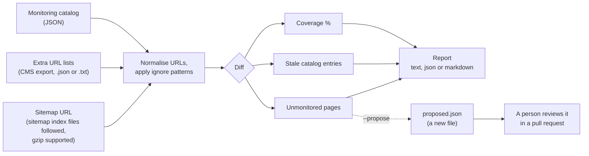

# sitemap-coverage-audit

Find the pages your uptime monitoring does not cover, by diffing your sitemap against your monitoring list.

## Why this exists

A sitemap is written for search engines, and it often leaves out pages that exist: landing pages
published from a CMS, pages another team added, pages marked noindex. A monitoring list is
written by hand and drifts the other way: it keeps checks for pages that were deleted or renamed
long ago, and nobody adds checks for new pages. So a dashboard can look green while a page that
matters is not watched at all. This tool compares the two lists and shows which pages are
unmonitored and which entries are stale, so a person can decide what to do.

## How it works



The tool only reads. It never changes your catalog. With `--propose` it writes a separate new
file, and it refuses to overwrite a file that already exists.

## Install

You need Python 3.12 or newer. The project uses [uv](https://docs.astral.sh/uv/).

```bash
# from a clone of this repository
uv sync
uv run sitemap-audit --help

# or install the command on your PATH
uv tool install .
```

`pip install .` works as well. The examples below call `sitemap-audit` directly. Inside a clone
that you have only synced, write `uv run sitemap-audit` instead.

## Usage

```bash
sitemap-audit --sitemap https://www.example.com/sitemap.xml --catalog catalog.json
```

```text
sitemap-audit --sitemap URL --catalog FILE
              [--extra FILE ...] [--ignore REGEX ...]
              [--format text|json|markdown] [--propose FILE] [--fail-on-gaps]
              [--timeout SECONDS] [--retries N] [--max-depth N] [--max-urls N]
              [--user-agent TEXT]
```

| Option | What it does |
|---|---|
| `--sitemap URL` | Sitemap or sitemap index. Index files are followed recursively. `.xml.gz` files work. |
| `--catalog FILE` | The monitoring catalog (see below). |
| `--extra FILE ...` | Extra lists of live URLs, for pages the sitemap does not list. JSON in the catalog format, or `.txt` with one URL per line. Can be given several times. |
| `--ignore REGEX ...` | Skip URLs that match. Applies to the sitemap, the extra lists and the catalog alike, so an ignored page is neither unmonitored nor stale. Searched in the normalised URL. |
| `--format` | `text` (default), `json` or `markdown`. |
| `--propose FILE` | Write a new JSON file: a copy of the catalog plus the unmonitored URLs. Never overwrites an existing file. Nothing is written when there are no gaps. |
| `--fail-on-gaps` | Exit with code 1 when at least one live page is unmonitored. Stale entries do not count as gaps. |
| `--timeout`, `--retries` | Per request timeout (15 s) and extra attempts after a timeout, connection error, 429 or 5xx (2), with a doubling delay. |
| `--max-depth`, `--max-urls` | Safety limits for sitemap trees: nesting of index files (5) and total page URLs (100000). Hitting a limit is an error, never a silent cut. |
| `--user-agent` | The User-Agent header. The default is `sitemap-audit/<version>`. When you audit a site you do not run, add contact details. |

Exit codes: `0` ok, `1` gaps found with `--fail-on-gaps`, `2` usage or input error (bad flags, an
unreadable or invalid file, a sitemap that cannot be fetched or parsed).

### Try it offline

The `examples/` folder has a small sitemap index, a catalog and a CMS export. Serve the folder
and run the audit against it:

```bash
python3 -m http.server 8765 --directory examples &
sitemap-audit \
  --sitemap http://localhost:8765/sitemap.xml \
  --catalog examples/catalog.json \
  --extra examples/extra-urls.json
```

```text
Sitemap coverage audit
Sitemap: http://localhost:8765/sitemap.xml

Coverage:        70.0% (7 of 10 live pages)
Live pages:      10 (sitemap 8, only in extra sources 2)
Catalog entries: 9
Unmonitored:     3
Stale entries:   2

Unmonitored pages (live, but not in the catalog):
  https://www.example.com/blog/2026-roadmap     [sitemap]
  https://www.example.com/help/getting-started  [extra sources only]
  https://www.example.com/landing/spring-offer  [extra sources only]

Stale catalog entries (in the catalog, but not live):
  https://www.example.com/legacy/faq
  https://www.example.com/old-promo
```

Without `--extra`, the same run reports 87.5% and misses the two pages that only the CMS export
knows about. The same report as Markdown is in
[`examples/sample-report.md`](examples/sample-report.md). Stop the demo server with `kill %1`.

### Catalog format

A JSON list. Each item is either a URL string or an object with a `url` field:

```json
[
  "https://www.example.com/",
  { "url": "https://www.example.com/pricing", "name": "Pricing", "interval_seconds": 60 }
]
```

Other fields on an object are allowed and are kept as they are in a proposal. A problem in the
file is reported with the entry number, for example `entry 2, field 'url': Field required`. If
your monitoring provider exports a different shape, convert it to this one first.

### How URLs are compared

Before comparing, every URL is normalised:

- the scheme and host are lowercased
- the fragment (`#...`) is dropped
- trailing slashes are removed, so the site root is `https://www.example.com`
- default ports (`:80` for http, `:443` for https) are dropped
- the tracking parameters `utm_*`, `gclid` and `fbclid` are removed

The case of the path and the order of the other query parameters are kept. Reports and proposals
show the normalised form. Coverage is the share of live pages that are in the catalog, rounded
down to one decimal, so `100.0%` really means nothing is missing.

## Use it with Claude Code

[`skill/SKILL.md`](skill/SKILL.md) is a Claude Code skill that teaches an agent to run the
audit, read the report and open a pull request with the proposed additions. Copy it into the
project that holds your monitoring catalog, or into your user folder:

```bash
# for one project
mkdir -p .claude/skills/sitemap-coverage-audit
cp skill/SKILL.md .claude/skills/sitemap-coverage-audit/SKILL.md

# for every project on your machine
mkdir -p ~/.claude/skills/sitemap-coverage-audit
cp skill/SKILL.md ~/.claude/skills/sitemap-coverage-audit/SKILL.md
```

Then ask something like "audit our monitoring coverage against https://www.example.com/sitemap.xml".
The skill is explicit about one rule: a production catalog is changed only through a reviewed
pull request, never directly. The agent runs the audit, puts the additions on a branch, leaves
stale entries for a person to decide, and does not merge.

## Limits

- It can only find pages that the sitemap or an extra list knows about. A page in neither is
  invisible to it, which is why `--extra` exists.
- It compares URLs. It does not ask your monitoring provider anything, and it does not check that
  an existing check is healthy.
- The catalog must hold exact URLs. Catalogs that use wildcards, regexes or path prefixes cannot
  be matched.
- It reads XML sitemaps (`urlset` and `sitemapindex`), also gzipped. Plain text and feed
  sitemaps are not supported. Extra lists can be JSON or `.txt`.
- It is strict. If any sitemap in the tree cannot be fetched or parsed, or a limit is hit, the
  run stops with exit code 2. A partial list would show up as false stale entries.
- Redirects are followed when fetching sitemaps, but not resolved when comparing pages. `www`
  and non-`www` hosts are different hosts.
- A proposal adds the `url` field only. Other fields your catalog needs have to be filled in by
  hand.
- Requests are sent one at a time, so a very large sitemap tree takes a while. It does not read
  `robots.txt` and does not honour `Retry-After`.

## Development

```bash
uv sync
uv run pytest
uv run ruff check .
uv run ruff format --check .
```

The tests use `respx` to mock HTTP, so they need no network. Fixtures are in `tests/fixtures`.

## Licence

MIT, see [LICENSE](LICENSE). Copyright (c) 2026 Augusto Gentile.
